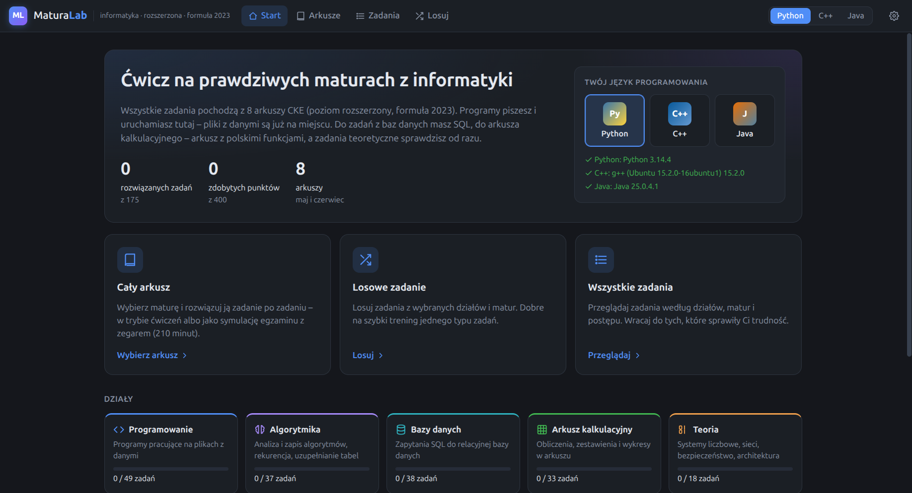
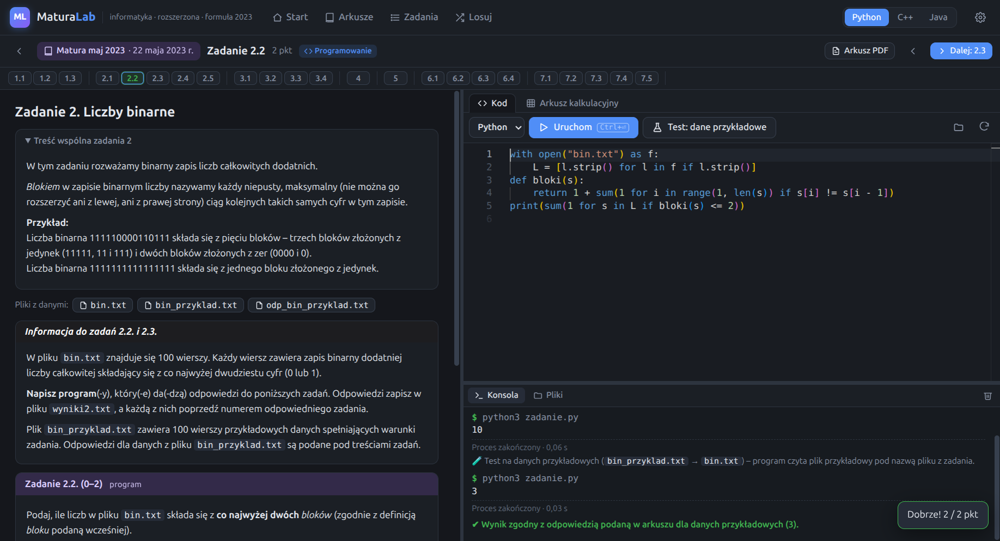
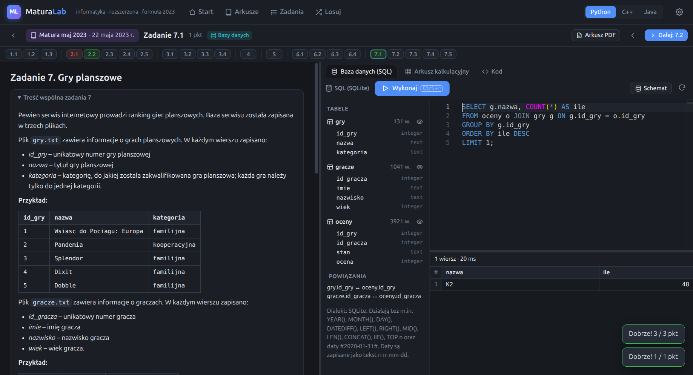
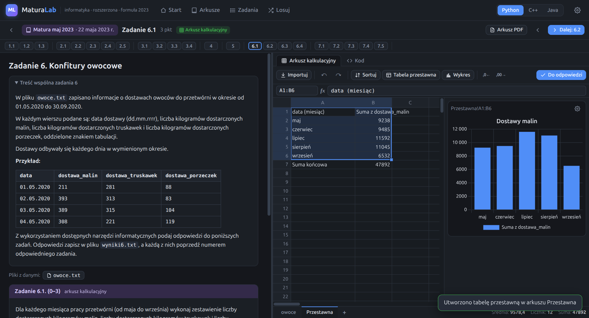

# Informatura

**Ćwiczenie matury z informatyki (poziom rozszerzony, formuła 2023) na prawdziwych arkuszach.**
Rozwiązujesz zadania z egzaminów CKE w jednym programie. Kod piszesz i uruchamiasz w Pythonie,
C++ albo Javie, zapytania SQL wykonujesz na wbudowanej bazie, a obliczenia robisz we wbudowanym
arkuszu kalkulacyjnym. Pliki z danymi są już w programie, więc nic nie trzeba pobierać.



## Co jest w środku

- **8 matur, 175 zadań, 400 punktów:** maj i czerwiec 2023, 2024, 2025 i 2026.
  - Wszystkie zadania pochodzą z oryginalnych arkuszy CKE. Żadne nie jest wymyślone.
  - Przy każdym zadaniu widać, z której matury pochodzi (data egzaminu) i jaki ma numer.
- **Cały arkusz:** rozwiązujesz maturę zadanie po zadaniu.
  - **Tryb ćwiczeń:** każde zadanie sprawdzasz od razu i możesz zajrzeć do rozwiązania.
  - **Symulacja egzaminu:** zegar 210 minut, sprawdzanie dopiero na końcu i podsumowanie punktów według działów.
- **Losowe zadanie:** losujesz z wybranych działów i matur.
- **Przeglądanie:** wszystkie zadania z filtrami według działu, matury i postępu.
- **Oryginał pod ręką:** przycisk *Arkusz PDF* otwiera oryginalny arkusz na stronie z danym zadaniem.
  Klucz odpowiedzi CKE też jest w programie.

### Programowanie: Python, C++ lub Java



- Edytor z podświetlaniem składni (ten sam co w VS Code).
- Konsola, w której widać wynik programu i w której można wpisywać dane wejściowe.
- Pliki z danymi (np. `bin.txt`) leżą w folderze roboczym zadania, więc program otwiera je jak na egzaminie.
- **Test: dane przykładowe** uruchamia program na pliku przykładowym i porównuje wynik z odpowiedzią podaną w arkuszu.
- Zadania z algorytmów (napisz funkcję, uzupełnij pseudokod) mają gotowy szablon w wybranym
  języku i testy: przykłady z arkusza i losowe przypadki.

### Bazy danych: SQL w stylu Accessa



- Tabele z zadania są już zaimportowane, a schemat i powiązania widać z boku.
- Silnik to SQLite. Działają też funkcje znane z Accessa i MySQL:
  - `YEAR()`, `MONTH()`, `DAY()`, `DATEDIFF()`;
  - `LEFT()`, `RIGHT()`, `MID()`, `LEN()`, `CONCAT()`, `IIF()`;
  - `TOP n` oraz daty w zapisie `#2020-01-31#`.
- Wynik zapytania jednym kliknięciem trafia do pola odpowiedzi.

### Arkusz kalkulacyjny z polskimi funkcjami



- Formuły po polsku jak w Excelu (`SUMA`, `JEŻELI`, `LICZ.JEŻELI`, `WYSZUKAJ.PIONOWO`, `ROK`, `DZIEŃ.TYG` …)
  ze średnikiem jako separatorem. W ustawieniach można przełączyć na nazwy angielskie.
- Zaznaczanie, przeciąganie formuł, kopiuj/wklej i cofanie.
- Sortowanie, tabela przestawna i wykresy.
- Dane z pliku są już wczytane, a daty i godziny są rozpoznane.

### Teoria

- Zadania prawda/fałsz, wybór odpowiedzi i uzupełnianie tabel: systemy liczbowe, sieci,
  architektura komputerów, bezpieczeństwo, analiza algorytmów.
- Są sprawdzane automatycznie według klucza CKE, z punktacją częściową tam, gdzie przewiduje ją klucz.

### Sprawdzanie odpowiedzi

- Odpowiedzi liczbowe i tekstowe są porównywane z kluczem CKE.
  - Liczy się treść, nie forma: przecinek i kropka, kolejność wierszy (gdy nie ma znaczenia) czy zapis daty nie przeszkadzają.
  - Punkty częściowe są przyznawane według zasad oceniania z klucza.
- Zadań, których nie da się sprawdzić automatycznie (wykresy, zapis algorytmu, opis), nie ocenia program.
  Po odsłonięciu rozwiązania i zasad oceniania przyznajesz sobie punkty sam.
- Postęp, kod i odpowiedzi zapisują się automatycznie.

## Czego potrzebujesz

Informatura uruchamia Twój kod na Twoim komputerze, więc potrzebny jest kompilator albo interpreter
języka, w którym piszesz. Wystarczy jeden z nich.

| Język | Co zainstalować | Ubuntu / Debian |
|---|---|---|
| Python | Python 3 | `sudo apt install python3` |
| C++ | g++ z obsługą C++17 lub nowszego | `sudo apt install g++` |
| Java | JDK 11 lub nowszy | `sudo apt install default-jdk` |

Na Windowsie: Python z [python.org](https://www.python.org/) (zaznacz *Add python.exe to PATH*),
C++ z [MSYS2](https://www.msys2.org/) (`pacman -S mingw-w64-ucrt-x86_64-gcc`), a Java z [Adoptium](https://adoptium.net/).
W *Ustawieniach* programu widać, co zostało wykryte. Można tam też wskazać ścieżkę ręcznie.

Bazy danych, arkusz kalkulacyjny i zadania teoretyczne nie wymagają niczego dodatkowego.

## Instalacja

### Z gotowej paczki (Linux)

`npm run dist` buduje w folderze `dist/` dwa pliki:

- `Informatura-<wersja>.AppImage` dla dowolnej dystrybucji. Nadaj mu prawo do uruchamiania (`chmod +x`) i uruchom.
- `informatura_<wersja>_amd64.deb` dla Debiana i Ubuntu. Instalujesz go poleceniem:

```bash
sudo apt install ./dist/informatura_0.1.0_amd64.deb
```

### Ze źródeł

Potrzebny jest Node.js 20 lub nowszy.

```bash
npm install
```

```bash
npm start
```

Skrót w menu aplikacji (bez uprawnień roota) dodasz poleceniem:

```bash
npm run install-desktop
```

## Dla programistów

| Polecenie | Co robi |
|---|---|
| `npm start` | uruchamia program |
| `npm run dev` | uruchamia z narzędziami deweloperskimi (F12) |
| `npm test` | testy jednostkowe: sprawdzanie odpowiedzi, kompletność treści, to, że oficjalne odpowiedzi z klucza dostają pełne punkty |
| `npm run test:e2e` | testy całej aplikacji w Electronie: uruchamianie kodu w trzech językach, SQL, arkusz, symulacja, wyświetlanie każdego z 175 zadań |
| `npm run verify-content` | skrypty w `tools/ref/` liczą odpowiedzi z plików danych i porównują je z kluczem CKE |
| `npm run pack` | buduje nierozpakowaną wersję do `dist/linux-unpacked` |
| `npm run dist` | buduje AppImage i .deb |
| `npm run dist:win` | buduje instalator i wersję przenośną dla Windowsa |

Gotową paczkę można szybko sprawdzić. To polecenie otwiera zadanie każdego rodzaju i wypisuje `SELFTEST OK`:

```bash
INFORMATURA_SELFTEST=1 dist/linux-unpacked/informatura --no-sandbox
```

### Struktura

- `main.js`: proces główny Electrona. Serwuje aplikację pod `informatura://app/`, otwiera PDF-y i obsługuje IPC.
- `src/runner.js`: kompilacja i uruchamianie kodu (Python, g++, javac), folder roboczy zadania, limity czasu i testy.
- `renderer/`: interfejs.
  - `renderer/js/views/`: ekrany programu.
  - `renderer/js/ws/`: edytor kodu, SQL i arkusz.
  - `renderer/js/sheet/`: silnik arkusza i siatka.
  - `renderer/js/check.js`: sprawdzanie odpowiedzi.
- `content/exams/<matura>.js`: treść zadań, klucz i zasady oceniania dla każdej matury.
- `content/data/<matura>/`: pliki z danymi. `content/pdf/`: oryginalne arkusze i klucze. `content/img/`: rysunki z arkuszy.
- `sources/`: arkusze i załączniki w postaci pobranej z arkusze.pl.

## Źródła i licencja

Zadania, pliki z danymi, rysunki i klucze odpowiedzi pochodzą z matur z informatyki
(poziom rozszerzony, formuła 2023) Centralnej Komisji Egzaminacyjnej. Pobrano je z
[arkusze.pl](https://arkusze.pl/), a prawa do nich należą do CKE. Program służy wyłącznie do nauki.

Kod programu jest udostępniony na licencji GNU GPL v3 (`LICENSE`), bo korzysta z biblioteki
HyperFormula na licencji GPL. Pozostałe biblioteki i ich licencje są wymienione w
[THIRD_PARTY_NOTICES.md](THIRD_PARTY_NOTICES.md).
